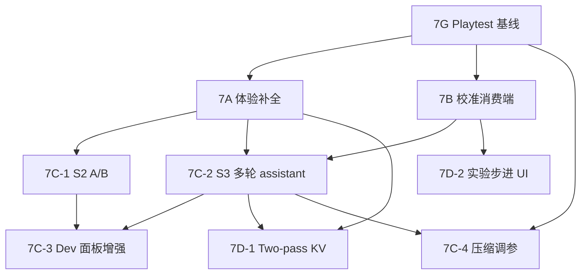

# 蓝图 v8（Phase 7）：体验补全 + 校准消费端 + KV 进阶 —— Phase 5/6 遗留 backlog

> 状态：**Phase 7 已执行（7A/7B/7C/7D 全量）** | 日期：2026-06-24 | 版本：v1.1  
> 前置依赖：  
> - [BLUEPRINT-KV-CACHE-TIMESTEP-PHASE6.md](./BLUEPRINT-KV-CACHE-TIMESTEP-PHASE6.md) v1.2（6A/6B/6D 核心已执行）  
> - [BLUEPRINT-AI-METADATA-PHASE5.md](./BLUEPRINT-AI-METADATA-PHASE5.md) v6.3  
> 外部参考：[DeepSeek 上下文硬盘缓存](https://api-docs.deepseek.com/zh-cn/guides/kv_cache)

---

## 0. 总原则（继承 Phase 6，不可违反）

| 优先级 | 原则 |
|--------|------|
| **P0** | **娱乐性 / 游戏性** — 叙事连贯、记忆不丢、世界观与数值一致 |
| **P1** | **体验补全** — 大步进不断层、减寿有后果、事件节奏贴世界观 |
| **P2** | **成本 / KV 优化** — 仅在 P0/P1 基线 playtest 通过后推进 |

**决策门：** 每步对比人工叙事评分 +（P2 项）`hitRate` / input token；质量降 → **回滚该子项，不阻塞其余项**。

---

## 1. 背景：Phase 5/6 已交付 vs 本 Phase 范围

### 1.1 已完成（不再重复实施）

| 来源 | 已完成项 |
|------|----------|
| Phase 5 | 5A faith→cultivation；5B-A macro birthRateModifier→family；5C 审计 + IT-1/2/4/5 |
| Phase 6 | 6A Prompt 完整接线 + 压缩管线；6B 时间步进 UI/Resolver/50+ 子系统；6D-2/3/4/7 |
| 基础设施 | `prompt-flags.ts`；`scripts/kv-prompt-audit.mjs`；Settings 缓存 hitRate 面板 |

### 1.2 本 Phase 纳入（用户确认「均可做、无冲突」）

| 轨道 | ID 前缀 | 项数 | 娱乐收益 |
|------|---------|------|----------|
| **7G** Playtest 门控 | 7G-* | 1 组 | 验收基线，决定 P2 是否值得 |
| **7A** 体验补全 | 7A-* | 4 | **高** |
| **7B** 校准消费端 | 7B-* | 3 | **中–高** |
| **7C** KV / 记忆进阶 | 7C-* | 5 | 中（记忆+省钱） |
| **7D** 可选增强 | 7D-* | 4 | 低–中（按需） |

### 1.3 明确排除（本 Phase 仍不做）

| 项 | 原因 |
|----|------|
| 子系统全面 `advance()` 迁移 | Phase 6 TS-4 已文档化；40+ 文件、收益小 |
| 多 Provider KV 策略 | DeepSeek 为主 |
| 压缩 UI 动画 | 非核心 |
| `memory-lifecycle` 架构重写 | Phase 6 已证实问题在接线，非设计 |
| IT-6 causal-simulation 结构改造 | 维持概率门现状；仅可选 narrative token 微调（7D-4） |

---

## 2. 冲突与依赖分析（可并行性）

> **结论：本 backlog 项之间无架构互斥**；仅存在 **顺序建议** 与 **A/B 门控**，可拆成独立 PR 增量交付。

### 2.1 依赖图



### 2.2 冲突矩阵

| 项 A | 项 B | 关系 | 说明 |
|------|------|------|------|
| 7C-1 S2 双 user | 7C-2 S3 多轮 | **互斥运行时** | 同一 narrative 调用只能选 S1/S2/S3 之一；用 flag 切换，**不同时默认开启** |
| 7C-2 S3 | 7C-4 压缩调参 | 协同 | S3 改变 message 结构后需重测压缩触发阈值 |
| 7A-1 TS-5 bridge | 7C-* | 无冲突 | bridge 注入 `eventInjection` 速变段，与 KV 策略正交 |
| 7B-1 fertilityModifier | 5B-A birthRateModifier | **语义 dedup** | 方案 B 文档已规定 macro vs micro 分工；实施时更新 Prompt dedup 表 |
| 7B-2 eventTypeWeights | narrative-prompt tone | 无冲突 | 权重影响 timeline 采样；tone 注入 narrative system 段 |
| 7A-2 lifespan 减寿 | narrative-prompt | 无冲突 | 读 Round N 叙事文本，Round N+1 生效 |
| 7D-1 Two-pass | 7C-2 S3 | **叠加成本** | Two-pass ≈2× API；S3 增加 history token；可同时开但费用高，默认仍关 |
| 7B-3 adaptation 校准 | world-init 流程 | 无冲突 | 仅创建期 Prompt 追加块 |

### 2.3 推荐并行批次

| 批次 | 可并行 PR | 预估 |
|------|-----------|------|
| **Batch 0** | 7G playtest 记录模板 | 0.5 天（人工） |
| **Batch 1** | 7A-1 TS-5 · 7A-2 lifespan · 7B-3 adaptation | 2–3 天 |
| **Batch 2** | 7B-1 fertility · 7B-2 eventTypeWeights | 2 天 |
| **Batch 3** | 7C-2 S3（主）· 7C-4 CMP-3 | 3–4 天 |
| **Batch 4** | 7C-1 S2 A/B · 7C-3 Dev 面板 · 7C-5 system 示例精简 | 1–2 天 |
| **Batch 5** | 7D-* 按需 | 1–3 天 |

---

## 3. 问题清单（按轨道）

### 3.1 Phase 7G — Playtest 门控（必做，零代码优先）

| ID | 内容 | 验收标准 |
|----|------|----------|
| **7G-1** | 基线 playtest 3 局 × 15–30 轮 | 记录叙事评分 1–5、记忆召回、大步进体感 |
| **7G-2** | Phase 6 清单复验 | §6 三项全部 ✅ 方可进入 7C P2 |
| **7G-3** | 基线 metrics 快照 | Settings hitRate、avg input tokens、压缩 L1 首次出现轮次 |

**Playtest 记录表（复制使用）：**

| 局 | 轮数 | 校准引用 | 3 轮前事件 recall | 3年步进数值 | 评分 | 备注 |
|----|------|----------|-------------------|-------------|------|------|
| 1 | | | | | | |
| 2 | | | | | | |
| 3 | | | | | | |

**7G 完成标准：** 至少 2/3 局评分 ≥4，且无 P0 回归（校准/记忆/步进全失效）。

---

### 3.2 Phase 7A — 体验补全（P1）

#### 7A-1 TS-5：大步进 Bridge Summary

**问题：** `year×10` / `year×50` / `year×100` 一次推进多 tick，叙事 Prompt 仍只描述「当前年」，中间年份断层。

**位置：**

- `src/mods/mod-engine/utils/time-step-resolver.ts`
- `src/mods/mod-engine/subsystems/orchestrator-system.ts` → `assemblePromptContext`
- 新：`src/mods/mod-engine/helpers/time-bridge-summary.ts`

**设计：**

```ts
interface TimeBridgeSummary {
  fromYear: number
  toYear: number
  tickCount: number
  /** 本地规则生成，不额外调 AI */
  bullets: string[]  // 子系统 delta 摘要、timeline 窗口内事件标题
}
```

**触发条件：** `simulationTicks >= 10`（可配置 `BRIDGE_SUMMARY_MIN_TICKS`）。

**注入点：** `narrative-prompt` 速变段新增 `timeBridgeSummary`（排在 `eventInjection` 之后、`currentState` 之前）。

**数据来源（本地、零 API）：**

| 来源 | 内容 |
|------|------|
| `world-timeline-system` | 窗口内 `[fromYear, toYear]` 骨架事件 title |
| 关键子系统 snapshot diff | population / cultivation / wealth 变化率（超阈值才写） |
| `memory-lifecycle` | 期间触发的 L0 标题列表 |

**验收：**

- [ ] year×10 一步：user prompt 含 `timeBridgeSummary` 且 bullets ≥3
- [ ] 叙事不再只写最后一年（人工 2 局盲测）
- [ ] year×1 / year×3 不触发 bridge（无多余 token）

---

#### 7A-2 Lifespan 叙事减寿接线

**问题：** `lifespan-system.ts` → `checkLifespanReduction()` 仍为 TODO，叙事「折寿/禁术」无数值后果。

**位置：** `src/mods/mod-character/subsystems/lifespan-system.ts`

**设计：**

1. Round N 叙事完成后，orchestrator 将 `lastNarrativeText` 写入 `RoundContext` 或 lifespan 可读 store。
2. Round N+1 `collectState` 初，`checkLifespanReduction` 扫描 `LIFESPAN_REDUCTION_KEYWORDS`。
3. 匹配 → `maxAge -= yearsLost`（取最严重一组，单次一条），写 UI note。

**dedup：** 不与 `lifespanBreakthrough` 叠算；减寿仅改 `maxAge`，不改当前 `age`。

**验收：**

- [ ] 叙事含「折寿十年」类关键词 → 下轮 maxAge -10
- [ ] 无关键词 → maxAge 不变
- [ ] `npm run test:calibration` 回归通过

---

#### 7A-3 NarrativeTone 注入叙事 System

**问题：** Step 0 / tag defaults 产出 `styleGuide.narrativeTone`，叙事主路径未读。

**位置：**

- `src/mods/mod-engine/prompts/narrative-prompt.ts`
- `src/mods/mod-engine/subsystems/orchestrator-system.ts`

**设计：** `assemblePromptContext` 读取 calibration `styleGuide.narrativeTone`，映射 `world-tag-defaults` 中文标签，注入 stable 段 `narrativeToneHint`（≤30 字）。

**验收：**

- [ ] 恐怖世界观局：system/user stable 段含 tone hint
- [ ] 叙事文风可感知差异（人工 1 局对比）

---

#### 7A-4 压缩 Importance 调参（CMP-3）

**问题：** L1–L6 已接通，默认 `rateImportance` / boostFactor 未针对长局调优。

**位置：** `src/mods/mod-engine/subsystems/summary-compressor-system.ts` · `memory-lifecycle-system.ts`

**设计：** 基于 7G 长局（30+ 轮）日志，调整：

- 婚约/突破/死亡类 `importance` boost
- L1 触发阈值（当前轮数 / token 估算）

**验收：**

- [ ] 50 轮局：L1 摘要覆盖 10 轮前关键事件（人工 recall）
- [ ] 压缩后 narrative token 较 6A 基线 ≤ 原 90%（同存档对比）

---

### 3.3 Phase 7B — 校准消费端补全（P1–P2）

#### 7B-1 fertilityModifier（Phase 5B 方案 B）

**问题：** macro `birthRateModifier` 与 family `BIRTH_PROBABILITY` 绑定（5B-A）；无法「宏观人口少 + 玩家家族多子」。

**新增字段：** `WorldCalibrationFormulas.fertilityModifier`（L2，默认 1.0）→ 总字段 **51**。

**公式：**

```
familyBirthChance = BIRTH_PROBABILITY × fertilityModifier
populationBirth   = base × birthRateModifier   // 不变
```

**文件：**

| 步骤 | 文件 |
|------|------|
| 7B-1.1 | `mod-world/types.ts` · `world-calibration-prompt.ts` dictionary |
| 7B-1.2 | `mod-culture/subsystems/family-system.ts` |
| 7B-1.3 | `buildDefaultCalibration`：postApocalyptic `fertilityModifier=0.7` 可选 |
| 7B-1.4 | Prompt dedup 表：macro vs micro 语义分离 |

**验收：**

- [ ] `birthRateModifier=0.5, fertilityModifier=1.5` → 人口降、家族生育升
- [ ] wiring-audit 登记第 51 项
- [ ] Step 0 sparse 用例不混淆两字段

---

#### 7B-2 eventTypeWeights 消费端

**问题：** AI 可输出 `styleGuide.eventTypeWeights`，timeline / past-history **未按权重采样**。

**位置：**

- `src/mods/mod-world/subsystems/world-timeline-system.ts`
- `src/mods/mod-world/constants`（25 种 `WorldTimelineEventType`）

**设计：**

1. `getEventDistributionStrategy()` 已有 L3；扩展读 `eventTypeWeights` 覆盖默认分布。
2. 骨架生成 `pickEventType()` 按权重加权随机。
3. past-history 生成同步权重。

**验收：**

- [ ] 权重 `{ war: 3, romance: 0.1 }` 的世界：10 个骨架事件 war 占比明显升高
- [ ] 缺省 weights → 行为与现网一致

---

#### 7B-3 adaptation-* Prompt 校准注入

**问题：** `formatAdaptationCalibrationBlock()` 已导出，**20 个 adaptation prompt 中仅 3 个**模板含 `worldCalibrationSummary`，**零调用方**使用 helper。

**范围：** 全部 `src/mods/**/prompts/adaptation-*.ts` + 对应 campaign / world-init 调用点。

**设计：**

1. 统一模板尾追加 `{{worldCalibrationSummary}}`（或 helper 拼接）。
2. world-init bundle 在 Step 0 完成后传入 `formatCalibrationSummary()`。
3. 空摘要时 omit（与 `OMIT_EMPTY_PROMPT_FIELDS` 一致）。

**验收：**

- [ ] `rg worldCalibrationSummary adaptation` ≥ 20 文件
- [ ] 新世界创建 debug log：adaptation 调用含校准块
- [ ] 无重复 W02 字段（人工 spot check 2 个 prompt）

---

### 3.4 Phase 7C — KV / 消息架构进阶（P2，7G 通过后）

> Phase 6 已完成：6D-2/3/4/7。本轨道补 **6D-1/5/6** + CMP-4 + system 精简。

#### 7C-1 S2 双 user A/B（6D-1）

**现状：** `KV_TWO_USER_SEGMENTS = false`（S1 默认）。

**步骤：**

1. 7G 记录 S1 基线 hitRate + 叙事评分。
2. 改 flag → `true`，同存档 10 轮对比。
3. 决策：hitRate ≥ +15% **且** 评分不降 → 保留；否则回滚 false。

**文件：** `prompt-flags.ts` · `prompt-builder.ts` · `scripts/kv-prompt-audit.mjs`（断言 S2 结构）

---

#### 7C-2 S3 多轮 assistant 滑动窗口（6D-5）

**问题：** 单轮 user-only 请求无法利用 DeepSeek 多轮前缀缓存；长局 assistant 历史丢失。

**新模块：** `src/core/ai-service/conversation-messages.ts`

```ts
interface ConversationBuildOptions {
  systemPrompt: string
  stableUserJson: string      // 与 S1 相同 stable 前缀
  slidingWindow: number       // 默认 6 轮 user+assistant 对
  currentUserJson: string     // 本轮速变 JSON
}

function buildConversationMessages(opts): ChatMessage[]
// → [system, user(stable), assistant(ack), user/assistant × N, user(current)]
```

**assistant 内容来源：** 历史 `narrativeHistory` 中存 full narrative text（已有）。

**滑动窗口：** 保留最近 N 对；更早内容依赖 memory L1+（与 7A-4 协同）。

**Feature flag：** `KV_CONVERSATION_MODE: 'S1' | 'S2' | 'S3'` 替换布尔 `KV_TWO_USER_SEGMENTS`。

**验收：**

- [ ] 同存档 20 轮：hitRate ≥ S1 基线 +15% 或 input token -10%
- [ ] blind 叙事连贯性 ≥ S1 基线
- [ ] JSON 解析 / stream 降级链不变

---

#### 7C-3 Dev 面板增强（6D-6）

**现状：** Settings 已有 aggregate hitRate。

**增强：**

| 字段 | 来源 |
|------|------|
| 每轮 strategy | orchestrator 写入 roundMetrics |
| stablePrefixChars | prompt-builder 统计 |
| userMessageCount | ai-client 发送前 |
| 最近 10 轮 mini chart | localStorage `roundCacheMetrics[]` |

**文件：** `mod-ui/.../SettingsTabTheme.tsx`（或 Debug 子 Tab）

---

#### 7C-4 narrativeHistory 双轨去重深化（CMP-4 / 6D-3 延伸）

**现状：** `DEDUP_NARRATIVE_HISTORY=true` 时 memory 有 L0 → history 缩 2 条。

**深化：**

- L0 与 history 文本 hash 去重（避免同事件双份）
- S3 模式下 history 只进 assistant role，不再重复进 user JSON

**验收：** 同事件不在 user JSON 与 assistant 各出现一次。

---

#### 7C-5 System Prompt 示例精简（6D-3 延伸）

**条件：** 7C-1 或 7C-2 A/B 通过后。

**内容：** 缩短 system 内 JSON 示例重复字段；**禁止**删除规则性约束文本。

**验收：** system token -5%~10%；叙事评分不降。

---

### 3.5 Phase 7D — 可选增强（P3，按需）

| ID | 内容 | 说明 |
|----|------|------|
| **7D-1** | Immersion Two-pass + KV 联调（KV-4） | Pass1/2 共享 system + stable user 前缀；默认仍 `IMMERSION_TWO_PASS_ENABLED=false` |
| **7D-2** | 实验步进 UI（日/月/季） | 7B 完成后可选暴露；子系统 tick 近似，需逐项 playtest |
| **7D-3** | entities.* L1 深度校准 | `world-entity-system` 读 Step 0 entities 范围微调生成量；非阻塞 |
| **7D-4** | IT-6 causal-simulation narrative token | 仅 Prompt 层结构校准，不改概率门算法 |

---

## 4. 分阶段执行计划

### 推荐顺序（娱乐优先）

```
7G Playtest 基线（人工，1 天）
    ↓ 基线 OK
┌───────────────────────────────────────┐
│ Batch 1 并行：7A-1 TS-5 │ 7A-2 lifespan │ 7B-3 adaptation │
└───────────────────────────────────────┘
    ↓ playtest 2 局
┌───────────────────────────────────────┐
│ Batch 2：7B-2 eventTypeWeights │ 7B-1 fertility（可选）│ 7A-3 tone │
└───────────────────────────────────────┘
    ↓ 长局 30+ 轮
7A-4 CMP-3 压缩调参
    ↓ 7G-2 复验通过
7C-2 S3（主 KV 升级）
    ↓ A/B
7C-1 S2 │ 7C-3 Dev 面板 │ 7C-4/5 精简
    ↓ 按需
7D-* 可选
```

### 最小可行子集（时间紧）

仅做：**7G + 7A-1 + 7A-2 + 7B-2** → 覆盖最大娱乐痛点（大步进断层、减寿无效、事件节奏）。

### 全量子集（用户当前选择）

**7G → 7A 全部 → 7B 全部 → 7C 全部 → 7D 按需**

预估：**10–15 人天**（含 playtest 与 A/B），可分 5–8 个 PR。

---

## 5. Feature Flag 汇总（Phase 7 新增）

```ts
// src/core/ai-service/prompt-flags.ts — 建议扩展

/** 消息策略：S1 单 user | S2 双 user | S3 多轮 assistant */
export type KVMessageStrategy = 'S1' | 'S2' | 'S3'
export const KV_MESSAGE_STRATEGY: KVMessageStrategy = 'S1'

/** year×N 达到此 tick 数时注入 bridge summary */
export const BRIDGE_SUMMARY_MIN_TICKS = 10

/** S3 滑动窗口保留对话对数 */
export const KV_CONVERSATION_WINDOW = 6

/** 叙事减寿关键词检测 */
export const LIFESPAN_NARRATIVE_REDUCTION_ENABLED = true
```

**现有 flag（保持不变）：**

| Flag | 默认 | Phase 7 动作 |
|------|------|--------------|
| `KV_TWO_USER_SEGMENTS` | false | 7C-1 后 deprecated → 迁到 `KV_MESSAGE_STRATEGY` |
| `IMMERSION_TWO_PASS_ENABLED` | false | 7D-1 联调 |
| `USE_AI_SUMMARY_COMPRESSION` | true | 7A-4 调参 |
| `DEDUP_NARRATIVE_HISTORY` | true | 7C-4 深化 |

---

## 6. 验收命令（PDCA C 闸）

```bash
cd ai-life-sim
npx tsc --noEmit
npm run test:calibration          # 含 kv-prompt-audit
node scripts/kv-prompt-audit.mjs  # 7C 后扩展 S2/S3 断言
```

**新增脚本（Phase 7 产出）：**

| 脚本 | 用途 |
|------|------|
| `scripts/adaptation-calibration-audit.mjs` | 断言 20 个 adaptation prompt 含校准变量 |
| `scripts/event-type-weights-smoke.mjs` | 固定 seed 下权重采样分布 |
| `scripts/time-bridge-smoke.mjs` | tick≥10 时 bridge 字段存在 |

**人工 playtest（7G + 每 Batch 后）：**

1. 新局 5 轮：tone / 校准 / 事件类型符合世界观
2. 连续 20 轮：记忆 recall +（7C 后）KV 策略对比
3. year×10 一步：bridge 摘要 + 叙事覆盖期间
4. 减寿叙事 1 次：下轮 maxAge 变化

---

## 7. 风险与回滚

| 风险 | 缓解 |
|------|------|
| S3 改变 message 结构 → 解析失败 | 保留 S1 为默认；降级链 fallback S1 |
| fertilityModifier 与 macro 叙事分裂 | Prompt dedup + 7B-1.4 验收用例 |
| bridge summary 过长 | bullets cap 8 条 × 40 字；omit 空 diff |
| 减寿关键词误触 | 白名单语境 + 单次每轮最多 1 条 |
| Phase 7 范围膨胀 | 严格按 Batch 交付；7D 不阻塞关闸 |

**回滚：** 每项独立 flag；移除 7B-1 字段可回退 5B-A 行为。

---

## 8. 与主蓝图同步项

| 主蓝图位置 | Phase 7 完成后更新 |
|------------|-------------------|
| `BLUEPRINT-AI-METADATA.md` §11.2 Defer family | 7B-1 完成后 → ✅ 方案 B |
| `BLUEPRINT-AI-METADATA-PHASE5.md` G-04 | 7B-2 完成后 → ✅ |
| `BLUEPRINT-AI-METADATA-PHASE5.md` G-12 | 7B-3 完成后 → ✅ 全调用方 |
| `BLUEPRINT-KV-CACHE-TIMESTEP-PHASE6.md` §10 6D | 7C 完成后 → 6D 全 ✅ |
| wiring-audit | 51 字段 + adaptation 计数 |

---

## 9. 决策记录（评审填表）

| 决策项 | 推荐 | 评审结论 |
|--------|------|----------|
| 是否全量执行 Phase 7 | 用户已确认均可做 | ✅ 已执行 |
| 7B-1 fertilityModifier | 实施（用户选全量） | ✅ |
| 7C 默认策略 | S3 完成后仍 **S1 默认**，A/B 门控切换 | ✅ S1 默认 |
| 7D 是否纳入首版 | 7C 关闸后纳入 | ✅ 已实施（Two-pass KV / 实验步进 flag / causal hint） |
| IT-6 | 维持排除，7D-4 可选 | ✅ causalChainHint 仅 Prompt |

---

## 10. 变更记录

| 版本 | 日期 | 说明 |
|------|------|------|
| v1.0 | 2026-06-24 | 初版：整合 Phase 5/6 backlog；冲突分析；7G/7A/7B/7C/7D 五轨道 |
| v1.1 | 2026-06-24 | **已执行**：7A–7D 全量；新增 audit 脚本；默认 KV S1 |

---

*文档结束 — 确认 §9 决策表后可按 §4 顺序实施；实施完成后同步 Phase 5/6 主蓝图状态。*
