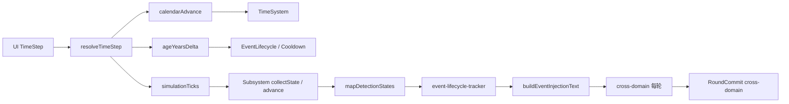

# 蓝图 v8（Phase 12）：时间尺度 / 事件检测 / 跨域联动 / 生命周期一致性

> **状态**：✅ Phase 12A 已落地（2026-06-25）| 📋 Phase 12B/C 待执行 | **版本**：v1.1  
> **前置依赖**：[ARCHITECTURE-ITERATION-PLAN.md](./ARCHITECTURE-ITERATION-PLAN.md) Phase 10–11（RoundCommit / RuntimeRegistry / 跨域校验 / Simulation Worker）  
> **关联调研**：对话「按日推进违和感」根因分析（2026-06-25）

---

## 0. 总原则（不可违反）

| 优先级 | 原则 |
|--------|------|
| **P0** | **时间语义一致** — 日历推进量、子系统模拟量、事件生命周期、跨域冷却必须同一套时间基准 |
| **P0** | **检测可观测** — 宏观 10 维 + 角色 4 维事件检测必须能真正读到子系统数据 |
| **P1** | **叙事连贯** — 灾难 → 平息 → 新事件的时间线符合玩家直觉（尤其日推模式） |
| **P2** | **性能 / 兼容** — 年推模式行为不退化；Worker 路径保持可降级 |

任何改动若导致「年推」模式数值明显偏离 Phase 11 基线 → 回滚并补回归用例。

---

## 1. 调研结论摘要

### 1.1 根因：三套时间尺度未对齐

| 维度 | 玩家/UI 理解 | 当前实现 | 后果 |
|------|-------------|---------|------|
| **日历** | 点「推进 1 天」→ +1 天 | `TimeSystem.advance` 正确 | UI 显示日推进 |
| **子系统模拟** | 1 天 ≈ 1/365 年 tick | `resolveTimeStep('day',1)` → `simulationTicks = max(1, round(1/365)) = **1**` | **每次日推等价跑 1 年模拟** |
| **事件生命周期** | 「持续 N 天」 | `consecutiveRounds` / `ending` 清理由 **`totalRounds`（点击次数）** 计 | 日推时「轮」被误读为「天」 |
| **跨域冷却** | 灾难后数周/数月不再连环触发 | `cooldownRounds` 按 **`totalRounds`** | 日推 5 次 = 冷却 5「轮」但背后已模拟 ~5 年 |

### 1.2 根因：事件检测层与子系统 ID 断链

`orchestrator.getDetectionStates()` 传入 `{ economy, population, climate, ... }`（子系统 id → `data`），  
而 `event-lifecycle-tracker.ts` 的 `DetectionStates` 期望 `{ marketState, populationState, climateState, ... }`。

**宏观 10 维检测几乎恒为空**；仅角色驱动 4 维（`health`、`morality` 等，键名与子系统 id 一致）可触发。

### 1.3 根因：跨域阶段守卫 + 宏观关键词错位

| 问题 | 位置 | 影响 |
|------|------|------|
| Campaign 阶段 6 仍要求 `ctx._eventInjectionText` | `campaigns/default/index.ts` L105 | 无宏观注入文本时 **整段跨域不跑**（含 dataCondition 规则 6–11） |
| 宏观规则靠 `description` 关键词 | `cross-domain-rules.ts` L77–346 | 描述来自生命周期事件名拼接，与「灾难」「战争」等关键词常不匹配 |
| `economy` 无 `priceIndex` 字段 | `mod-economy/economy-system.ts` | 即使映射修复，市场类检测仍缺数据源 |

### 1.4 根因：子系统推进未统一消费 `simulationTicks`

| 现象 | 位置 |
|------|------|
| `subsystem-advance` 调 `advanceAllSubsystems()`，多数子系统 **无 `advance()` 实现** | `orchestrator-system.ts` |
| 实际推进在 `collectState()` 内，且多处 **硬编码 `advanceEconomy(1)`** | `economy-system.ts` L121 |
| `population.advancePopulation` 每轮按 **全年出生率** 算一次，未乘 `ageYearsDelta` | `population-system.ts` |
| `conflict-cycle` 用 `for (y < getSimulationTicks)` 整数年循环 | 日推时仍为 1 |

### 1.5 管线对照（目标态）



---

## 2. 问题清单（按优先级）

### 2.1 P0 — 时间步进语义（必须修）

#### TS-12-1：`simulationTicks` 日推被 `Math.max(1, …)` 抬升为 1 年

**位置：** `src/mods/mod-engine/utils/time-step-resolver.ts`

**现状：**

```ts
case 'day':
  simulationTicks: Math.max(1, Math.round(step.value / DAYS_PER_YEAR))
// 1 天 → round(0.0027) = 0 → max(1,0) = 1
```

**修复目标：**

1. `ResolvedTick` 增加 `simulationYears: number`（= `ageYearsDelta`，显式命名，避免与整数 tick 混淆）。
2. `simulationTicks` 改为 **仅用于仍依赖整数年循环的子系统**；日推时允许 `0`。
3. 月/季/年：`simulationTicks = Math.round(simulationYears)` 或 `Math.max(1, …)` 仅当年推 ≥1 年时。

**验收：**

- 单元测试：`resolveTimeStep({ unit:'day', value:1 })` → `simulationYears ≈ 1/365`，`simulationTicks === 0`。
- 单元测试：`resolveTimeStep({ unit:'year', value:1 })` → `simulationTicks === 1`。

---

#### TS-12-2：`RoundContext` 暴露 `ageYearsDelta` / `calendarDaysDelta`

**位置：**

- `src/foundation/types/subsystem.types.ts` — `RoundContext` 扩展
- `src/mods/mod-engine/subsystems/orchestrator-system.ts` — `buildRoundContext()`

**修复目标：**

```ts
interface RoundContext {
  // 已有 simulationTicks, timeStep
  ageYearsDelta?: number      // 本轮角色年龄增量（年）
  calendarDaysDelta?: number  // 本轮历法天数（用于生命周期/冷却）
}
```

**验收：** `buildRoundContext()` 在 day/month/season/year 各档下字段与 `resolveTimeStep` 一致。

---

#### TS-12-3：子系统推进统一按 `ageYearsDelta` 缩放

**位置（首批，按 `getSimulationTicks` grep 命中优先）：**

| 子系统 | 文件 | 改法 |
|--------|------|------|
| economy | `mod-economy/.../economy-system.ts` | `collectState` 内 `advanceEconomy(context.ageYearsDelta ?? getSimulationTicks(context), …)` |
| population | `mod-economy/.../population-system.ts` | 出生/死亡/城镇化 × `ageYearsDelta` |
| climate | `mod-environment-ecology/.../climate-system.ts` | 灾害触发概率 × `calendarDaysDelta` |
| ecology | `mod-environment-ecology/.../ecology-system.ts` | 相位漂移 × `ageYearsDelta` |
| conflict-cycle | `mod-politics/.../conflict-cycle-system.ts` | 整数循环改为 **累加 `ageYearsDelta`** 或概率步进 |
| culture-tech, education, legal, social-values | 对应 `*-system.ts` | 同上模式 |
| fortune-encounter | `mod-power-system/.../fortune-encounter-system.ts` | `cooldownRounds` 改为日历感知（见 CD-12-1） |

**模式（推荐）：**

```ts
const years = context.ageYearsDelta ?? getSimulationTicks(context) / DAYS_PER_YEAR
if (years <= 0) return // 日推零 tick 时跳过年尺度随机跳变
// 连续量：delta *= years
// 离散事件：accumulator += years; while (accumulator >= 1) { ...; accumulator -= 1 }
```

**验收：**

- 日推 365 次后人口/经济总量 ≈ 年推 1 次（误差 < 5%，随机种子固定时 deterministic）。
- 日推 1 次：子系统数值变化量 ≈ 年推 1 次的 1/365。

---

### 2.2 P0 — 事件检测状态映射（必须修）

#### EVT-12-1：新增 `mapSubsystemStatesToDetectionStates()`

**位置：** `src/mods/mod-engine/helpers/detection-state-mapper.ts`（新文件）

**职责：** 将 `Record<subsystemId, data>` 转为 `DetectionStates`，**唯一映射入口**。

**映射表（v1.0）：**

| DetectionStates 键 | 子系统 id | 字段映射 / 备注 |
|-------------------|-----------|----------------|
| `marketState` | `economy` | `priceIndex` ← 派生：`100 + currency.inflation * 10`（或 economy 新增显式字段） |
| | | `inflationRate` ← `currency.inflation / 100` |
| | | `volatility` ← `marketCycleProgress` 或新增 |
| `factionState` | `faction-dynamics` | `factions` ← `state.factions`（`power` 字段已有） |
| `climateState` | `climate` | `activeDisasters` 直传 |
| `populationState` | `population` | 直传 + 确保 `consecutiveDeclineYears` / `consecutiveGrowthYears` 在 advance 中维护 |
| `ecosystemState` | `ecology` | 直传 |
| `nationState` | `nation-relation` | `relations` 直传 |
| `nobleHouseState` | `social-stratification` | `houses` ← `nobleHouses.map(h => ({ name, prosperity: h.influence }))` |
| `tradeRouteState` | `economy` | `routes` ← `tradeRoutes`；`globalTradeMultiplier` ← `getTradeIncomeMultiplier()` |
| `cultureTechState` | `culture-tech` | 直传 |
| `economyState` | `economy` | `currency`, `debts` 直传 |
| `health` … `luck` | 同名子系统 id | 直传（已正确） |

**接线：**

- `orchestrator.extractDetectionStates()` → 调用 mapper
- `buildEventInjectionText(states, …)` 入参类型改为 mapper 输出

**验收：**

- 集成测试：构造 `economy` 高通胀快照 → 检测到「市场动荡」或「通货膨胀」。
- 集成测试：构造 `climate.activeDisasters` → 注入文本含「干旱」等。
- 调试页「运行时注册表」旁新增「事件检测快照」只读面板（可选 P1）。

---

#### EVT-12-2：`economy` 补充 `priceIndex`（可选与派生二选一）

**位置：** `mod-economy/subsystems/economy-system.ts` + `subsystem-field-registry.ts`

**方案 A（推荐）：** `advanceEconomy` 每轮更新 `priceIndex`（100 基准），检测与跨域共用。  
**方案 B：** 仅在 mapper 派生，不改 economy 状态。

**验收：** `marketState.priceIndex` 与 Prompt 中经济描述一致。

---

### 2.3 P0 — 跨域联动每轮执行（必须修）

#### XDOM-12-1：移除 Campaign 阶段 6 的 `eventInjectionText` 守卫

**位置：** `src/mods/mod-engine/campaigns/default/index.ts` L100–127

**修复目标：** 与 `orchestrator.executeRound` 注释一致 — **每轮** `await orchestrator.executeCrossDomainLinkage()`。

**保留逻辑：**

- 跨域后 `collectAllSubsystemStates()`
- 仅当 `hadMacroEvents`（跨域前有注入文本）时做二次 `buildEventInjectionText`（与 orchestrator L620–634 对齐）

**验收：**

- HP < 20 时，即使无宏观事件文本，规则 6（英雄陨落）仍触发并写入 RoundCommit。
- 单元/集成：`executeCrossDomainLinkage` 在空 `eventInjectionText` 下被调用 ≥1 次。

---

#### XDOM-12-2：宏观规则关键词与事件类型对齐

**位置：** `src/mods/mod-engine/helpers/cross-domain-rules.ts`

**修复目标（二选一，推荐 A）：**

**A. 扩展 `condition()` 匹配生命周期事件名：**

| 规则 | 现关键词 | 增补事件名 |
|------|---------|-----------|
| 生态灾难 | 灾难, 生态, 灭绝 | 生态崩溃, 生态恶化, 过度开发, 干旱, 洪涝, 严寒, … |
| 战争/冲突 | 战争, 冲突, 动乱 | 边境冲突, 国际紧张, 势力冲突, … |
| 贸易波动 | 贸易, 市场, 商路 | 贸易萎缩, 商路中断, 市场动荡, 市场崩溃, … |
| 社会动荡 | 动荡, 叛乱, 犯罪 | 世家没落, 人口流失, … |
| 技术突破 | 技术, 突破, 发明 | 技术突破, 文化复兴, … |

**B. 改 `DomainEvent.description` 为 `statusDesc` 拼接（更丰富语义）。

**验收：** 注入「生态崩溃(新发生)」后，规则 1 产出 `population` + `economy` 指令。

---

### 2.4 P1 — 生命周期日历化（体验核心）

#### LIFE-12-1：生命周期记录改用游戏内时间

**位置：** `src/mods/mod-engine/helpers/event-lifecycle-tracker.ts`

**类型扩展：**

```ts
interface EventLifecycleRecord {
  // 保留 round 字段兼容
  firstSeenRound: number
  lastSeenRound: number
  consecutiveRounds: number
  // 新增
  firstSeenDay?: number   // 累计游戏日（eraYear * 365 + dayOfYear）
  lastSeenDay?: number
  consecutiveDays?: number
}
```

**逻辑：**

- `buildEventInjectionText` 入参增加 `gameDay: number`（来自 `TimeSystem` 或 context）
- 文案：`持续第${consecutiveDays}天`（日推）/ `持续第${consecutiveRounds}轮`（年推）— 由 `timeStep.unit` 分支
- `ending` 清除：`roundsSinceEnded < 5` → `daysSinceEnded < endingLingerDays`（默认 5 天或按 severity 缩放）

**验收：**

- 日推：灾难注入后连续 3 天显示「持续第 3 天」，第 6 天起（恢复后）显示「已结束」最多 linger 5 天。
- 年推：行为与现网一致（`consecutiveRounds` 仍可用）。

---

#### LIFE-12-2：恢复阈值与模拟步长解耦

**问题：** 日推时子系统状态每日微变，宏观阈值可能「闪断」→ 事件一闪而过。

**修复：**

- `recoveryThresholds` 内比较使用 **平滑窗口**（连续 2 次检测满足才 ending）或 **最小持续天数**（`minDurationDays` per eventType）。
- 配置表：`EVENT_LIFECYCLE_POLICY` in `event-lifecycle-tracker.ts` 或 `constants/event-lifecycle.ts`。

**验收：** 人为抖动 `priceIndex` 一次不会立刻「市场动荡 → 已结束 → 新发生」。

---

### 2.5 P1 — 跨域冷却日历化

#### CD-12-1：`cooldownRounds` → `cooldownGameDays`

**位置：**

- `cross-domain-rules.ts` — 规则定义
- `simulation-kernel.ts` — 评估逻辑
- `world-event-bus`（或 orchestrator 持有的 cooldown 表）— 存储 `lastTriggeredDay`

**换算（默认）：**

| 原 cooldownRounds | 新 cooldownGameDays（日推基准） | 年推等价 |
|-------------------|--------------------------------|---------|
| 5 | 5 | 5 年 → 1825 天（或按设计取 5×365） |

**推荐策略：** 冷却始终用 **游戏内累计日**；年推 1 次 = `calendarDaysDelta` 365。

```ts
if (rule.cooldownGameDays) {
  const last = cooldowns[rule.id] ?? -Infinity
  if (gameDay - last < rule.cooldownGameDays) continue
  cooldowns[rule.id] = gameDay
}
```

**兼容：** 保留 `cooldownRounds` 读取路径 1 个版本，mapper 到 days = rounds × avgDaysPerStep。

**验收：** 日推连点 10 次，规则 1 最多触发 2 次（cooldown 5 天）。

---

#### CD-12-2：`fortune-encounter` 冷却对齐

**位置：** `mod-power-system/.../fortune-encounter-system.ts`

`cooldownRounds--` 改为 `cooldownGameDays -= context.calendarDaysDelta`。

---

### 2.6 P2 — 叙事约束与可观测性（可选）

#### NAR-12-1：Prompt 注入「活跃灾难禁止新宏观灾难」软约束

**位置：** `buildEventInjectionText` 输出 + `narrative-prompt` 模板

当 `ongoing` 宏观事件 severity ≥ 0.6 存在时，追加：

```text
【叙事约束】当前仍有未平息的宏观事件（{names}），本轮叙事应描写余波与应对，避免无关的新灾难。
```

**验收：** 人工抽检日推 20 轮，AI 叙事中「连环无关灾难」频率下降（主观 + debug log）。

---

#### OBS-12-1：调试页「模拟时间轴」面板

**位置：** `mod-pages/pages/debug-log/`

展示：当前 `gameDay`、`ageYearsDelta`、`simulationTicks`、活跃生命周期、跨域冷却剩余天数、最近 RoundCommit `cross-domain` 条目。

---

## 3. 执行分期（建议顺序）

### Phase 12A — P0 止血（1–2 会话）

| 序 | 任务 ID | 说明 | 依赖 |
|----|---------|------|------|
| 1 | TS-12-1, TS-12-2 | 时间解析 + RoundContext 扩展 | — |
| 2 | EVT-12-1, EVT-12-2 | 检测状态映射 + economy priceIndex | — |
| 3 | XDOM-12-1 | Campaign 跨域守卫移除 | — |
| 4 | XDOM-12-2 | 宏观规则关键词对齐 | EVT-12-1 |
| 5 | TS-12-3（核心子系统） | economy, population, climate, conflict-cycle | TS-12-1 |

**12A 关闸：** `npm run gate-check:quick` + 新增 `time-step-resolver` 单测

---

### Phase 12B — P1 体验（1–2 会话）

| 序 | 任务 ID | 说明 | 依赖 |
|----|---------|------|------|
| 6 | LIFE-12-1, LIFE-12-2 | 生命周期日历化 + 恢复防抖 | TS-12-2 |
| 7 | CD-12-1, CD-12-2 | 跨域 / 奇遇冷却日历化 | TS-12-2 |
| 8 | TS-12-3（余下子系统） | 全量 `getSimulationTicks` 命中文件 | 12A |

**12B 关闸：** `npm run gate-check` + 日推/年推各 30 轮手工回归清单

---

### Phase 12C — P2 抛光（可选）

| 序 | 任务 ID | 说明 |
|----|---------|------|
| 9 | NAR-12-1 | 叙事软约束 |
| 10 | OBS-12-1 | 调试时间轴面板 |

---

## 4. 文件变更清单（预估）

| 操作 | 路径 |
|------|------|
| 修改 | `src/mods/mod-engine/utils/time-step-resolver.ts` |
| 修改 | `src/foundation/types/subsystem.types.ts` |
| 修改 | `src/foundation/utils/round-advance.ts`（可选 `getAgeYearsDelta` helper） |
| 新增 | `src/mods/mod-engine/helpers/detection-state-mapper.ts` |
| 修改 | `src/mods/mod-engine/helpers/event-lifecycle-tracker.ts` |
| 修改 | `src/mods/mod-engine/helpers/cross-domain-rules.ts` |
| 修改 | `src/mods/mod-engine/simulation/simulation-kernel.ts` |
| 修改 | `src/mods/mod-engine/subsystems/orchestrator-system.ts` |
| 修改 | `src/mods/mod-engine/campaigns/default/index.ts` |
| 修改 | `src/mods/mod-economy/subsystems/economy-system.ts` |
| 修改 | `src/mods/mod-economy/subsystems/population-system.ts` |
| 修改 | `src/mods/mod-environment-ecology/subsystems/climate-system.ts` |
| 修改 | `src/mods/mod-environment-ecology/subsystems/ecology-system.ts` |
| 修改 | `src/mods/mod-politics/subsystems/conflict-cycle-system.ts` |
| 修改 | `src/mods/mod-power-system/subsystems/fortune-encounter-system.ts` |
| 新增 | `src/mods/mod-engine/utils/__tests__/time-step-resolver.test.ts`（或项目既有测试目录） |
| 新增 | `src/mods/mod-engine/helpers/__tests__/detection-state-mapper.test.ts` |
| 修改 | `docs/ARCHITECTURE-ITERATION-PLAN.md` — 登记 Phase 12 |
| 修改 | `docs/FACTORIO-LIFECYCLE-MAP.md` — 补充时间轴阶段 |

**不动（除非 12A 实测阻塞）：** `src/core/`、`src/foundation/` 除 `RoundContext` 类型扩展外。

---

## 5. 回归与验收矩阵

| 场景 | 操作 | 期望 |
|------|------|------|
| 日推 ×1 | 推进 1 天 | 日历 +1；人口变化 ≈ 年推 1/365 |
| 日推 ×365 | 连续 365 天 | 与年推 ×1 总量接近 |
| 年推 ×1 | 推进 1 年 | 与 Phase 11 基线偏差 < 5% |
| 宏观检测 | 手动抬高通胀 | Prompt 含市场类事件 |
| 跨域空注入 | HP=15，无宏观事件 | 规则 6 仍触发 |
| 灾难连贯 | 注入生态崩溃后日推 5 天 | 持续天数递增；冷却内不重复触发规则 1 |
| Worker 降级 | 禁用 Worker | 主线程跨域结果一致 |

---

## 6. 风险与回滚

| 风险 | 缓解 |
|------|------|
| 全子系统改 `ageYearsDelta` 工作量大 | 12A 只改核心 4 个；其余子系统日推时 `years<=0` 跳过 |
| `priceIndex` 派生公式与玩法不符 | 先用方案 B mapper；实测后升方案 A |
| 冷却从 round 改 day 导致年推冷却过长 | 配置表区分 unit 或 `cooldownGameDays = cooldownRounds * calendarDaysDelta` |
| 生命周期迁移丢存档 | `EventLifecycleRecord` 新字段可选；旧存档 `consecutiveDays` 回退 `consecutiveRounds` |

**回滚开关（建议）：** `WorldCalibration.formulas.useLegacyRoundTimeModel?: boolean` — 默认 `false`；`true` 恢复 Phase 11 行为。

---

## 7. 执行检查清单（交付用）

- [x] TS-12-1/2：`resolveTimeStep` 单测绿（smoke）
- [x] EVT-12-1：宏观事件检测映射接线
- [x] XDOM-12-1：Campaign 与 orchestrator 行为一致
- [x] XDOM-12-2：生态/战争规则关键词扩充
- [x] TS-12-3：核心子系统日推/年推缩放（economy/population/climate/conflict-cycle）
- [ ] LIFE-12-1：注入文案含「天」或「轮」正确分支
- [ ] CD-12-1：冷却按游戏日生效
- [x] `npm run gate-check:quick` 全绿
- [ ] `ARCHITECTURE-ITERATION-PLAN.md` Phase 12 状态更新

---

## 8. 与既有蓝图关系

| 文档 | 关系 |
|------|------|
| [BLUEPRINT-KV-CACHE-TIMESTEP-PHASE6.md](./BLUEPRINT-KV-CACHE-TIMESTEP-PHASE6.md) | Phase 6 TS-1「时间步进未接线」为本 Phase **子集**；12 补全语义与模拟一致性 |
| [ARCHITECTURE-ITERATION-PLAN.md](./ARCHITECTURE-ITERATION-PLAN.md) Phase 10–11 | RoundCommit / 跨域校验为本 Phase **前置**；12 修「数据进不去、时间对不上」 |

---

*最后更新：2026-06-25 — v1.0 待执行蓝图。*
