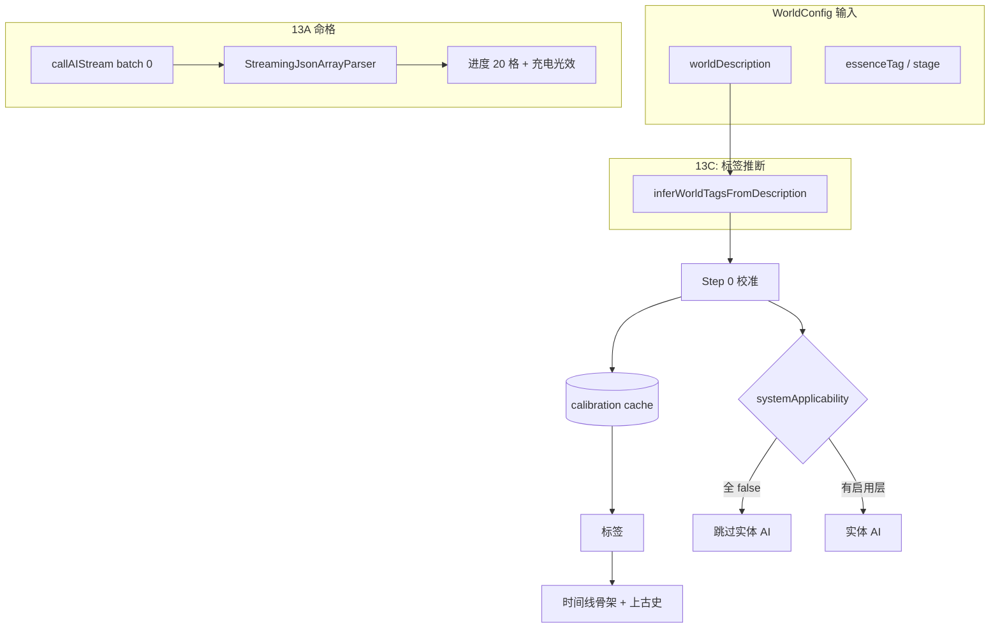

# 蓝图 v9（Phase 13）：世界初始化一致性 / 命格流式体验 / AI 调用降本

> **状态**：✅ 13A–13D 核心已落地（2026-06-25）| **版本**：v1.2  
> **日期**：2026-06-25  
> **前置依赖**：[ARCHITECTURE-ITERATION-PLAN.md](./ARCHITECTURE-ITERATION-PLAN.md) Phase 0–12 · [BLUEPRINT-TIME-EVENT-COHERENCE-PHASE12.md](./BLUEPRINT-TIME-EVENT-COHERENCE-PHASE12.md)  
> **关联调研**：对话「原始时代 / 地猿」world-init 日志 20 条逐项分析 + 命格抽取三问题修复（2026-06-25）

---

## 0. 总原则（不可违反）

| 优先级 | 原则 |
|--------|------|
| **P0** | **worldDescription > civilizationStage > essenceTag** — 所有 world-init / 命格 / 时间线 Prompt 与 Store 写入均不得被错误标签覆盖 |
| **P0** | **AI 调用可观测** — 一次 API = 一条完整 debug 日志（prompt + response）；禁止 silent 丢弃 response |
| **P1** | **降本不降质** — 合并调用须保持 JSON 契约可解析；跳过 AI 须有规则判定（非硬编码世界观列表） |
| **P2** | **体验可感知** — 命格首批流式：解析一条、进度一格、光效可见 |

任何改动若导致 world-init 5 路成功率低于当前基线（原始时代 playtest）→ 回滚并补回归日志对照。

---

## 1. 调研结论摘要

### 1.1 world-init 日志审计（20 条，`logs/ai-debug/world-init/`）

| 指标 | 结果 |
|------|------|
| 完整日志（含 AI 返回） | 11 / 20 |
| 缺失 AI 返回（仅 prompt + meta） | 9 / 20 — 均为**校准重试**，prompt ~4258 字符 |
| 世界观正确（地猿尺度） | 骨架时间线 ✅ · 上古史 ⚠️ · 实体 ✅ · 校准（首次）✅ |
| 标签被 essenceTag 带偏 | cultivation 会话 → 「洪荒、广漠星空」等 |
| 参数配置 AI 结果 | **调用成功但未入库**（纯浪费 1 次 API） |

### 1.2 根因矩阵

| ID | 根因 | 影响面 | 严重度 |
|----|------|--------|--------|
| **RC-13-1** | `generateWorldInitBundle` Config 步只 `await callAI`，不 parse / 不 `store.set*` | 参数配置步无效 | P0 |
| **RC-13-2** | `generatePastHistory` user 段缺 `coherenceHint` | 上古史出现「智人走出非洲」等错置 | P0 |
| **RC-13-3** | `essenceTag` / `civilizationStage` 与用户 `worldDescription` 脱节 | 校准 metadata 回写错误、eventStyleGuide 注入修仙/现代战争 | P0 |
| **RC-13-4** | 校准失败 → 整链重试，无成功结果缓存 | 9 条残缺日志、token 浪费 | P1 |
| **RC-13-5** | `systemApplicability` 全 false 仍调实体 AI | 多余 1 次 API（结果本可规则判定） | P1 |
| **RC-13-6** | `logAICallFireAndForget` 仅用 `sendBeacon`，大 payload 丢 `response` | 调试不可信 | P0（**13A 已修**） |
| **RC-13-7** | 5+ 路 AI 串行，system prompt 重复、无合并 | 单次世界初始化 6–8 次调用 | P1 |
| **RC-13-8** | 命格首批非流式，进度条长时间 0 | 抽取体验差 | P1（**13A 已修**） |
| **RC-13-9** | `onEarlyReady` 时 `state.candidates` 未同步 | 确认报无效 ID | P0（**13A 已修**） |

### 1.3 管线对照（目标态）



---

## 2. Phase 13A — 已落地（基线勿回退）

> **gate-check**：2026-06-25 通过

| # | 任务 | 文件 | 状态 |
|---|------|------|------|
| 13A-1 | 首批命格 `callAIStream` + 增量 JSON 解析 | `destiny-pattern-system.ts`, `streaming-json-array-parser.ts`, `talent-draw/page.tsx` | ✅ |
| 13A-2 | 进度条充电光效 + 20 格分段脉冲 | `TalentDraw.module.css`, `page.tsx` | ✅ |
| 13A-3 | 每批同步 `state.candidates` + confirm 候选池合并 | `destiny-pattern-system.ts`, `page.tsx` | ✅ |
| 13A-4 | 已选槽位与网格卡牌同尺寸 | `TalentDraw.module.css`, `page.tsx` | ✅ |
| 13A-5 | debug 日志大 payload → `fetch keepalive` fallback | `core/logger/debug-logger.ts` | ✅ |

**13A 回归清单（playtest）**

- [ ] 抽取页：流式过程中进度格逐个点亮，主条有光带扫过
- [ ] 首批 ≥12 条后可选取，确认 3 个命格不报无效 ID
- [ ] `logs/ai-debug/talent-generate/` 新日志含完整 AI 返回
- [ ] 后台 batch 2–5 仍非流式，命格库计数递增

---

## 3. Phase 13B — world-init P0 修复（✅ 2026-06-25 已落地）

### 3.1 WI-13-1：参数配置 AI 结果入库

**位置：** `src/mods/mod-world/world-init-bundle.ts` L373–381

**现状：**

```ts
await callAI(worldConfigPrompt.systemPrompt, ...)
// configGenerated = true，但 raw 未 parse、未写入 store
```

**修复目标：**

1. `parseAIJSON` + 现有 world config schema 校验
2. 写入 `useWorldStore` 对应字段（或 `WorldSnapshot` 扩展槽，与 `WorldInitSystem` 本地数学层 merge 策略写清）
3. 失败时不标 `configGenerated = true`

**验收：**

- [ ] 新 world-init 日志中 config 步返回的 JSON 可在 store 中读到（debug 页或单元测试）
- [ ] parse 失败 → `errors[]` 有项，`configGenerated = false`

**ATCE：**

| 维度 | Patch | 重构 |
|------|-------|------|
| 做法 | 在 bundle 内补 parse + setState | 抽出 `WorldConfigAIService` 统一 5 步 parse/store |
| 推荐 | **Patch（13B）** | 13C 合并调用时再抽服务 |

---

### 3.2 WI-13-2：上古史 Prompt 补 `coherenceHint`

**位置：**

- `src/mods/mod-world/subsystems/world-timeline-system.ts` — `generatePastHistory`
- `src/mods/mod-world/prompts/world-timeline-prompt.ts` — user 模板变量

**现状：** 骨架填充（`fillStageWithAI`）user 段含 `coherenceHint`；`generatePastHistory(15)` user 段**缺失**（日志 20-53-39：智人走出非洲）。

**修复目标：**

1. `generatePastHistory` 传入与 bundle 相同的 `buildWorldCoherenceHint(civilizationStage, description)`
2. system `eventStyleGuide` 在 prehistoric 判定时不得注入 cultivation 示例（联动 `buildTimelineStyleHint`）

**验收：**

- [ ] 原始时代 replay：上古史 15 条无「智人」「诸侯」等未启用层词汇
- [ ] 日志 user 段可见 `coherenceHint` 字段

---

### 3.3 WI-13-3：校准成功后缓存，避免标签错配重跑整链

**位置：** `world-init-bundle.ts` · `useWorldStore` 或 `cacheStore`

**修复目标：**

1. 校准成功 → 写入 `worldCode` 级缓存（含 `systemApplicability` 若 AI 返回）
2. 后续步骤失败重试时**不重复**校准（除非 `worldDescription` hash 变化）
3. bundle 入口：若 `essenceTag` 与推断结果冲突，**日志 warn** 并优先 description

**验收：**

- [ ] 同 worldCode 二次 init：校准日志 ≤1 条（或 cache hit 标记）
- [ ] 重试标签/时间线时不再出现 9 条「无 AI 返回」校准日志

---

### 3.4 WI-13-4：实体 AI 条件跳过

**位置：** `world-init-bundle.ts` L396–403 · `world-entity-system.ts`

**修复目标：**

```ts
if (calibration.entities 全 min=max=0 或 systemApplicability 全 false) {
  entitiesGenerated = true // 规则空结果，不调 AI
  return
}
```

**验收：**

- [ ] 地猿世界 init：实体步无 API 调用（或 log 标记 `skipped: rule-empty`）
- [ ] 有 nationCount.min>0 的世界仍正常调 AI

---

## 4. Phase 13C — 世界观推断 + AI 调用合并（✅ 2026-06-25 核心已落地）

### 4.1 WC-13-1：`essenceTag` / `civilizationStage` 推断

**位置：** 新世界确认链路

- `mod-pages/pages/world-select/useWorldConfirm.ts`
- `mod-pages/pages/world-customize/useWorldCustomize.ts`
- `mod-world/world-init-bundle.ts`（`commitWorldInitialization` / `generateWorldInitBundle` 入口）

**已落地：**

- `utils/world-coherence-inference.ts` — `inferWorldCoherenceFromDescription` + `applyCoherenceToWorldConfig`（尊重 `_coherenceLocks`）
- 确认 / 自定义 / 后台 init 入口均应用推断

**验收：**

- [x] 「地猿原始时代」playtest：init 前 essenceTag 被规则覆盖为 primitive/none
- [ ] 用户显式选「修仙模板」+ 史前描述 → UI 提示冲突并让用户确认（**Phase 14 可选**）

---

### 4.2 WC-13-2：AI 调用合并（降本）

| 合并项 | 预估节省 | 状态 |
|--------|----------|------|
| **校准 + 标签** | 1 call | ✅ `world-calibration-tags-prompt.ts` 合并 JSON；缓存含 tags |
| **时间线骨架 + 上古史** | 1 call | 📋 延后 Phase 14 |
| **config 步入库** | 0（原浪费） | ✅ 13B 已修 |
| **实体规则跳过** | 1 call | ✅ WI-13-4 |

**目标：** 单次后台 init 从 **6–8 次** → **4–5 次**（原始时代 **3–4 次**）。

**验收：**

- [ ] 对比合并前后 token 总量（需 playtest 日志对照）
- [x] 5 路 success 字段 + gate-check 通过

---

## 5. Phase 13D — 体验与配置（✅ 2026-06-25 核心已落地）

### 5.1 UX-13-1：角色创建性别默认

- [x] UI 显式标注「默认：男」（Content / Desktop / Mobile）
- [ ] 进入 timeline 前将 `male/female` 映射为中文「男/女」供叙事（**Phase 14 可选**）

---

### 5.2 UX-13-2：world-init 进度可观测

- [x] `WorldInitAIStatus.currentStep` + 命运预览页展示（含 `calibrationGenerated`，进度 **5/5**）
- [x] 失败项展示 `errors[]`（命运预览 banner）

---

## 6. ATCE 总表（Phase 13 整体）

| 维度 | Patch 累计 | 重构（推荐于 13C 末） |
|------|------------|----------------------|
| **做法** | 13B 四项独立修复 | `WorldInitPipeline` 类：步骤注册表 + 缓存 + skip 规则 |
| **短期** | 1–2 迭代可交付 | 3 迭代 |
| **长期** | bundle 函数持续膨胀 | 新世界观只加 step 配置，不改 bundle 巨函数 |
| **推荐** | **13B 用 Patch** | **13C 合并后做 REFACTOR** |

**推荐路径：** 13A（已完成）→ 13B Patch → 13C 合并 + 推断 → 13C 末抽 `WorldInitPipeline` → 13D 可选

---

## 7. 文件改动地图

| 阶段 | 主要文件 |
|------|----------|
| 13A ✅ | `mod-character/subsystems/destiny-pattern-system.ts`, `utils/streaming-json-array-parser.ts`, `mod-pages/.../talent-draw/*`, `core/logger/debug-logger.ts` |
| 13B | `mod-world/world-init-bundle.ts`, `world-timeline-system.ts`, `prompts/world-timeline-prompt.ts`, `world-entity-system.ts`, `store.ts` |
| 13C | `mod-world/utils/world-coherence-inference.ts`, `prompts/world-calibration-tags-prompt.ts`, `world-init-bundle.ts`, `mod-pages/world-*` |
| 13D | `mod-pages/character-create/*`, `mod-pages/fate-preview/page.tsx`, `mod-world/store.ts` |

---

## 8. 关闸与验收

```bash
cd ai-life-sim
npm run gate-check          # 13B/13C 全量
npm run check:structural    # 13C 重构前 ATCE
```

| 阶段 | 通过标准 |
|------|----------|
| 13B | gate-check ✅ + 原始时代 replay 日志 0 条「无 AI 返回」校准重试 + config 入库可测 |
| 13C | API 次数下降 ≥25% + essenceTag 与 description 一致 + 时间线上古史无错置 |
| 13D | 可选；不阻塞 13B/13C 发布 |

---

## 9. 排除范围（本 Phase 不做）

| 项 | 原因 |
|----|------|
| 重写 Step 0 Prompt 字段字典 | v5 已稳定；仅增补 coherence / skip 规则 |
| 命格 batch 2–5 流式化 | 收益低；用户已可提前选取 |
| 合并叙事主链 AI 调用 | 属 mod-engine 范畴，非 world-init |
| 全面 essenceTag UI 重做 | 13C 先做推断 + warn，完整 UX 可 Phase 14 |

---

## 10. 迭代顺序（建议排期）

```
Week 1  │ 13B-1 Config 入库
        │ 13B-2 上古史 coherenceHint
        │ 13B-4 实体 skip
Week 2  │ 13B-3 校准缓存
        │ Playtest + 日志对照
Week 3  │ 13C-1 描述推断覆盖标签
        │ 13C-2 校准+标签合并
Week 4  │ 13C-2 时间线合并（可选）
        │ WorldInitPipeline 重构（若 ATCE 批准）
```

---

*最后更新：2026-06-25 — v1.0 初稿，基于 world-init 20 条日志审计 + 13A 已落地项。*
